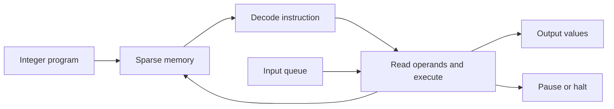

# Intcode Computer

A small, dependency-free JavaScript interpreter with resumable input, sparse
memory, explicit validation, and a command-line runner.

**Origin:** my 2019 Advent of Code solutions. **This edition:** a 2026 adaptation
of the Day 9 interpreter into a standalone module, with correctness fixes,
execution limits, and regression tests. It is not an unchanged historical release.

## Try it

Requires Node.js 24. No dependency installation or build step is needed.

```sh
npm run demo
# 42

node src/cli.js examples/double.csv 15
# 30

npm run check
```

The supplied example is a small original program that doubles an input. Output
values are written one per line, so the CLI can be used in shell pipelines.

## Use the interpreter

```js
import { Computer } from './src/computer.js';

const computer = new Computer([3,30,1002,30,2,30,4,30,99]);
computer.run();
// { status: 'waiting', outputs: [], steps: 0 }

computer.addInput(21).run();
// { status: 'halted', outputs: [42], steps: 4 }
```

Each `run()` returns only its new outputs. Missing input pauses execution at the
input instruction; `addInput()` lets it resume. The caller's program and input
arrays are copied. `read(address)` inspects memory without modifying it.

## Design



The machine supports arithmetic, input/output, conditional jumps, comparisons,
relative-base adjustments, and halt. Operands can use position, immediate, or
relative addressing. Unwritten memory reads as zero.

The instruction set comes from Eric Wastl's Advent of Code: [basic machine](https://adventofcode.com/2019/day/2),
[parameter modes and I/O](https://adventofcode.com/2019/day/5), and
[relative addressing](https://adventofcode.com/2019/day/9). Puzzle statements and
personal puzzle-input files are not distributed here. This is an independent
implementation, not an official Advent of Code tool.

## Boundaries

- Values and addresses must be JavaScript safe integers. Results beyond that
  range raise an error instead of silently losing precision; arbitrary-precision
  arithmetic is not implemented.
- Each run defaults to 100,000 instructions. Library callers can set
  `run({ maxSteps: 500_000 })`. Reaching the limit throws after partial execution;
  this is not a rollback mechanism.
- The CLI accepts a regular program file up to 1 MiB. Exit codes: `0` halted,
  `1` invalid input/execution error, `2` additional input required.
- Instructions operate only on the interpreter's memory and I/O queues. They
  cannot execute JavaScript, launch processes, access the network, or read files.
  The CLI reads only the program path explicitly supplied by its caller.
- This is an educational local tool, not a sandbox service for hostile workloads.

## Tests

`npm test` uses Node's built-in test runner. Coverage includes opcode behavior,
branch outcomes, relative addressing, sparse memory, pause/resume, immutable
caller inputs, precision errors, execution limits, parsing, and CLI exit codes.

## Contributing and license

[Contributing](CONTRIBUTING.md) · [Security](SECURITY.md) · [MIT license](LICENSE)

Salah-Eddine Lachkar · [Portfolio](https://lachkar.me)
